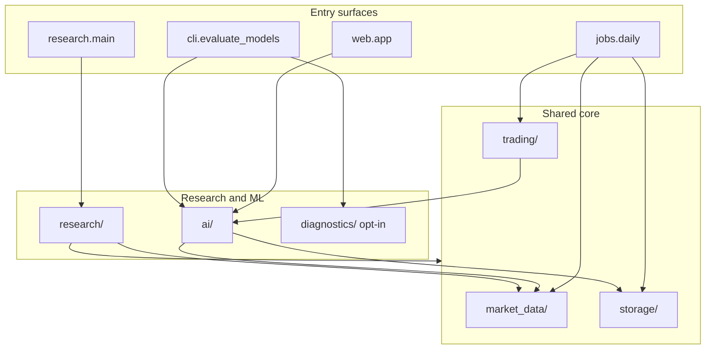

# Architecture

Single-repo modular monolith: one Python package (`stock_analysis/`) with several entry surfaces sharing storage and market-data infrastructure.

## Entry surfaces

| Surface | Entry point | Purpose |
|---------|-------------|---------|
| Interactive CLI | `python -m stock_analysis.research.main` | Exploratory analysis, stock finder, sector views |
| Web API | `python -m stock_analysis.web.app` | Flask REST API for movement classifiers |
| Daily trading job | `stock-analysis-daily` (`jobs.daily`) | One run: signal evaluation, orders via the configured broker, report |
| Trader scheduler | `stock-analysis-trader` (`jobs.scheduler`) | Long-running; triggers the daily job once per NYSE trading day (the `trader` compose service) |
| Risk CLI | `stock-analysis-risk` (`cli.risk`) | Inspect/clear the kill switch, reconcile local state against the broker |
| ML evaluation | `stock-analysis-evaluate` CLI | Temporal holdout classifier comparison |
| Strategy backtest | `stock-analysis-evaluate backtest` (`cli.backtest`) | Replays a portfolio config over history with the daily job's rules; report against buy-and-hold |
| Research scripts | `stock_analysis.ai.*` modules | Notebooks-style ML and valuation experiments |

## Layer diagram

## Import boundaries

- **`jobs/` and `trading/`** — production trading path. Use `market_data`, `storage`, `trading`, and `notifications` only. Do not import `research/`, `diagnostics/` or heavy research viz. Exception: `trading/signals/` reuses `ai/` for signal maths and model loading (`ma_signals`, `model_manager`, `movement_inference`).
- **`cli/risk.py`** — operator CLI. Uses `storage` and `trading` only.
- **`web/app.py`** — serves ML endpoints. Imports `ai/` only; no diagnostics by default.
- **`diagnostics/`** — opt-in statsmodels helpers. Never imported by `jobs/daily`, `web/app`, or paper-trading modules. Researchers and `cli/evaluate_models` may call it explicitly.
- **`backtest/`** — historical replay of the trading path. Calls the same `trading/` functions as the daily job (`get_signal_strategy`, `combine_signals`, `decide`, cost models, `check_kill_switch`) with in-memory state; no database, no broker. Uses `ai/` for walk-forward model training. Never imported by `jobs/` or `trading/`.
- **`research/`** — interactive CLI and exploratory scripts (sector analysis, stock finder, portfolio plots). May import `market_data` and `storage`; not used by the daily job.

## Package layout

| Path | Role |
|------|------|
| `stock_analysis/market_data/` | `MarketDataProvider` protocol and `YFinanceProvider` |
| `stock_analysis/storage/` | SQLite cache and paper-trading portfolio store |
| `stock_analysis/trading/` | Signals, `Broker` abstraction (paper simulator, Alpaca), kill switch, live-trading gate, daily report |
| `stock_analysis/jobs/` | Daily job (`daily.py`) and its scheduler (`scheduler.py`) |
| `stock_analysis/notifications/` | Email alerts (daily summary, failures, kill-switch trips) |
| `stock_analysis/backtest/` | Backtest engine, performance metrics, buy-and-hold benchmarks, walk-forward ML strategy, run log |
| `stock_analysis/cli/` | Non-interactive CLIs (`evaluate_models`, `backtest`, `risk`) |
| `stock_analysis/web/` | Flask app and templates |
| `stock_analysis/research/` | Interactive CLI and exploratory analysis modules |
| `stock_analysis/ai/` | ML models, classifiers, valuation |
| `stock_analysis/diagnostics/` | Opt-in time-series diagnostics (statsmodels) |
| `config/` | Runtime YAML (e.g. `portfolio.yaml`) |
| `scripts/ralph/` | Agent loop tooling (not runtime) |
| `scripts/finviz/` | Finviz scrape script (outputs to `finviz_recs/`) |
| `finviz_recs/` | Local scrape data (gitignored JSON) |

## Naming: `fundamentals` vs `fundamental_analysis`

Two similarly named areas under `ai/` serve different layers:

- **`ai/fundamentals/`** — data layer: `FundamentalsProvider` protocol, yfinance and EDGAR adapters, composite fallback.
- **`ai/fundamental_analysis/`** — analysis layer: valuation models (`StockValuation`), fin statement classifier, examples.

When adding features, put data fetching in `fundamentals/` and valuation logic in `fundamental_analysis/` (or a future `ai/valuation/` rename).

## Development tooling

Agent infrastructure (`.agents/`, `scripts/ralph/`, `skills-lock.json`) lives in the repo for Ralph/Cursor workflows but is not part of the runtime product.

See also [AGENTS.md](../AGENTS.md) and [stack-improvement-plan.md](stack-improvement-plan.md).
